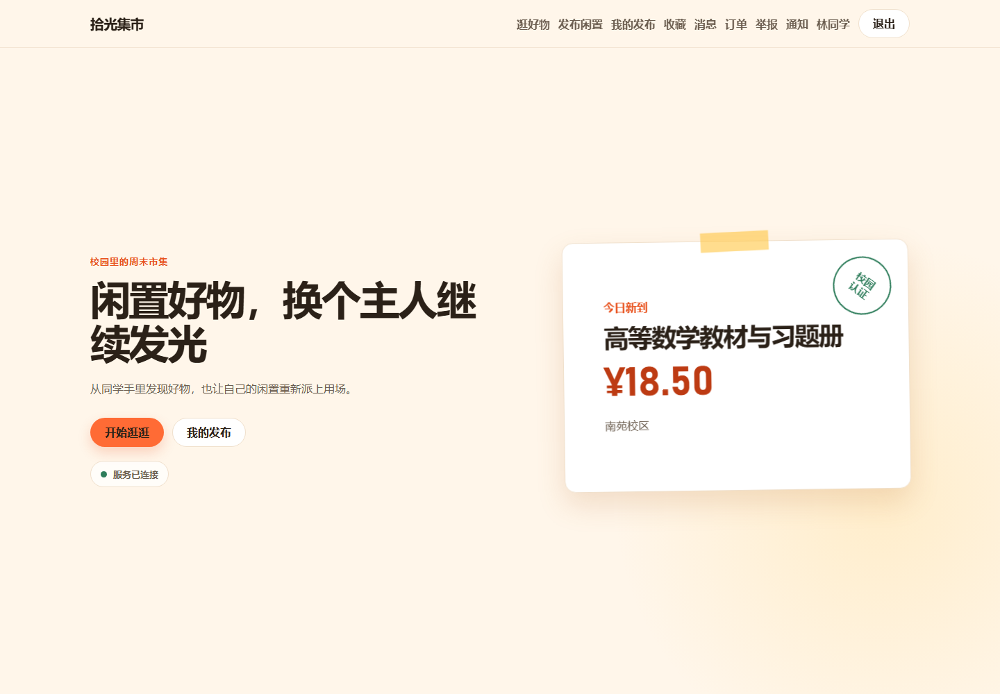
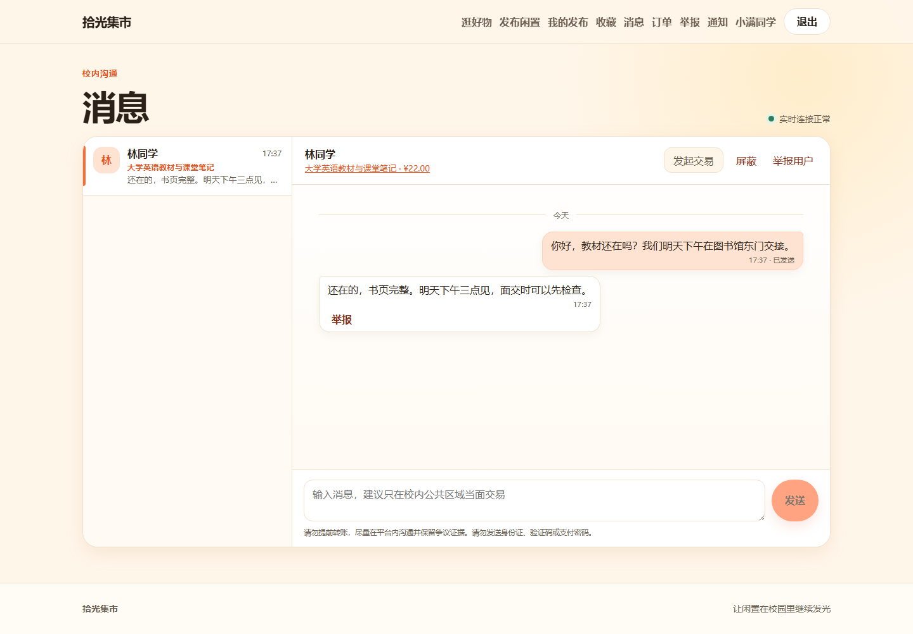
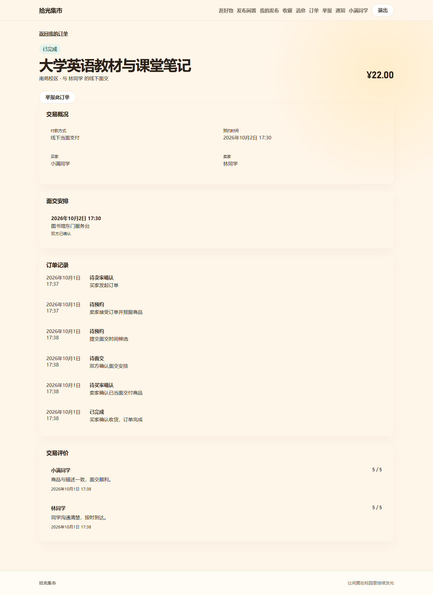
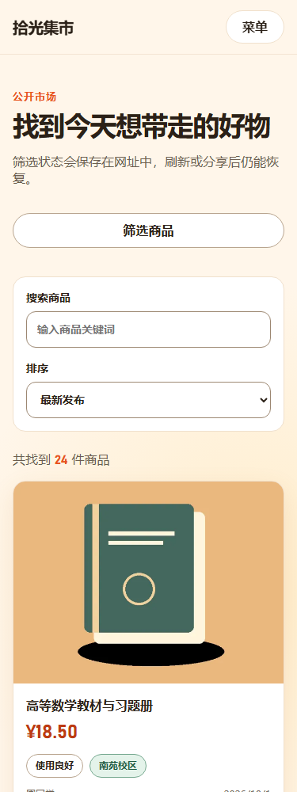
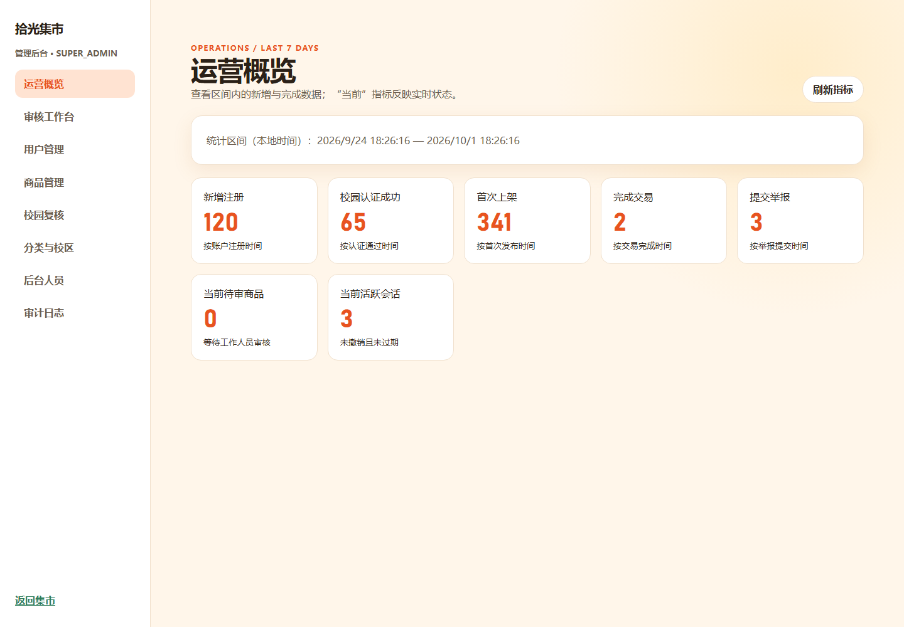
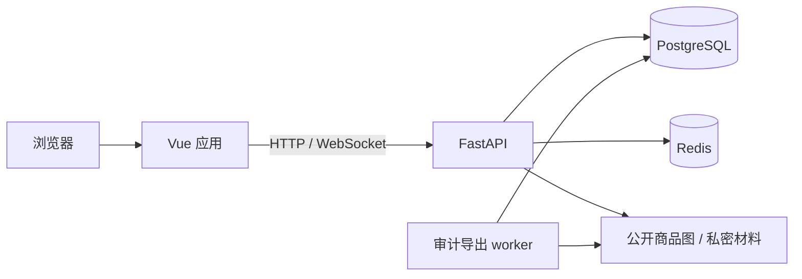

# 拾光集市

面向校园的二手交易平台，让闲置物品在同学之间继续使用。支持校园身份认证、商品审核、站内沟通、线下面交、双向评价，以及举报申诉和后台运营。



## 功能

| 使用场景 | 能力 |
| --- | --- |
| 发现闲置 | 分类、关键词检索、价格筛选、排序、商品详情与收藏 |
| 发布商品 | 分步填写、账户独立的本地草稿、多图上传、审核、撤回与重新提交 |
| 校园身份 | 普通邮箱注册，校园邮箱单独认证，私密材料人工申诉 |
| 沟通与交易 | WebSocket 站内聊天、通知、同校区订单、双方确认面交安排、交付与收货 |
| 信任与治理 | 交易双方评价、信用记录、举报证据、处罚、独立人员复核申诉 |
| 运营后台 | 用户与内容管理、校园认证审核、目录配置、工作人员权限、审计和异步导出 |
| 账户与隐私 | 密码找回、会话撤销、隐私说明和账号注销 |

当前使用线下交接和付款，不接入在线支付。市场公开展示在售商品；创建交易要求买卖双方有有效的同校区认证。后台工作人员权限属于平台范围，多校运营隔离方案见部署文档。

## 页面预览

以下图片来自本地实际运行的应用，内容为数据库中的演示数据；商品配图是演示插画。


<details>
<summary>查看聊天、交易、手机页面和运营后台</summary>









</details>

## 技术架构

| 部分 | 技术 |
| --- | --- |
| 前端 | Vue 3、TypeScript、Vite、Pinia、Vue Router、GSAP |
| 后端 | Python 3.12、FastAPI、Pydantic、SQLAlchemy 2、Alembic |
| 数据与任务 | PostgreSQL、Redis、常驻审计导出 worker |
| 文件 | 本地对象存储、受控商品图接口、带权限校验的私密下载 |
| 质量检查 | Ruff、严格 mypy、vue-tsc、ESLint、Prettier |



```text
backend/        API、领域服务、数据库迁移与运营命令
frontend/       页面、组件、状态与 API 客户端
docs/           项目规则、部署与运维方案、页面截图
scripts/        项目质量检查入口
.env.example    配置模板，不含真实凭据
```

## 本地运行

准备 Python 3.12、Node.js 24、pnpm 9.15.9、PostgreSQL 和 Redis。创建专用数据库 `campus_trading_platform`，保持 Redis 可连接。可以使用已有 Python 环境；下文的 `python` 应指向该环境。

在项目根目录复制配置模板，填写本地数据库、Redis、SMTP 和认证配置：

```powershell
Copy-Item '.env.example' 'backend/.env'
```

`.env` 已被 Git 忽略。API、迁移和 worker 必须使用同一有效配置；不要提交连接凭据或把密码写在命令行中。

在 `backend` 目录初始化并启动：

```powershell
python -m pip install -r requirements.txt
python -m alembic upgrade head
python -m app.db.seed
python -m app.db.bootstrap_super_admin
python -m uvicorn app.main:app --reload --host 127.0.0.1 --port 8000
```

种子命令用于首次安装角色、权限和默认分类。超级管理员初始化命令通过无回显提示接收密码，创建用户名 `guo`，首次登录必须改密；已有账号会拒绝覆盖。学校、校区和校园邮箱域名需要由运营方先录入，详见 [后端说明](backend/README.md)。

另外启动常驻 worker：

```powershell
python -m app.workers.audit_export
```

在 `frontend` 目录启动前端：

```powershell
pnpm install --frozen-lockfile
pnpm dev --host 127.0.0.1
```

访问 [本地应用](http://127.0.0.1:5173)。开发服务器代理 `/api` 和 WebSocket 到后端。开发模式 OpenAPI 位于 [API 文档](http://127.0.0.1:8000/docs)。

## 质量与维护

项目根目录的检查脚本执行后端格式、静态检查和严格类型检查，以及前端类型、Lint、格式和生产构建：

```powershell
./scripts/check.ps1 -Python '你的 Python 环境/python.exe'
```

收尾验收通过 113 项后端测试、17 项实际 PostgreSQL 检查和 48 项前端测试；真实浏览器覆盖交易、治理、账户恢复与运营流程，并完成 375、768、1024、1440 像素下共 124 次页面布局检查。验证码与密码找回使用真实 Redis、数据库流程及本地邮件投递接收器，外部 SMTP 需在正式环境另行验收。

按项目收尾要求，开发过程文档与验收脚本已移除，数据库演示数据保留；验收使用的后台演示账号已停用。后续功能修改应补充对应回归测试并重新运行实际浏览器旅程。

## 项目文档

- [后端介绍与运行](backend/README.md)
- [前端介绍与运行](frontend/README.md)
- [账户规则](docs/账户规则.md) · [隐私与账号注销](docs/隐私与账号注销说明.md)
- [图片存储策略](docs/商品图片存储策略.md) · [运维手册](docs/运维手册.md)
- [部署方案](docs/部署方案.md) · [发布流程](docs/发布流程.md)
- [监控与安全运维](docs/监控与安全运维.md) · [容量与多校路线](docs/容量与多校路线.md)

部署文档是待落地的设计方案，包含上线条件、回滚、备份和多校路线。当前交付为可本地运行的项目；生产基础设施、域名和正式运营资料需要在上线前落实。
