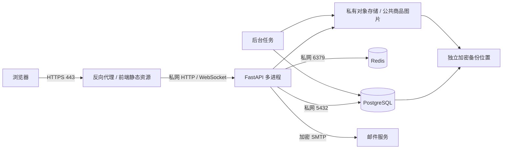

# 部署方案

本文提供拾光集市单校试运行的部署设计。尚未创建服务器、域名、证书、云存储或其他外部资源。正式部署前填写并确认平台、账号、域名、预算、负责人与学校授权。

## 拓扑与信任边界



- 公网只开放 443；80 仅用于 HTTPS 跳转或证书验证。API 端口只接受可信代理访问，数据库、Redis、对象存储管理端口不暴露公网。
- 商品图片通过当前授权与可见性检查后提供；申诉、举报材料及审计导出保持私有，不能把整个对象存储目录映射为静态资源。
- PostgreSQL 保存用户、商品、聊天、交易和治理事实；Redis 保存验证码、限流计数、一次性票据和实时广播，不作为业务事实唯一来源。
- API 与任务进程使用独立数据库账户。运行账号不具备建库或超级用户权限；迁移账号仅在发布窗口使用。
- 当前仓库使用本地对象存储。多实例前必须实现并验证共享对象存储适配器，不能把各实例本地磁盘视为一致存储。

## 起步方案与选择

| 方案 | 适合情形 | 成本与限制 |
| --- | --- | --- |
| 单机服务管理或容器编排 | 一所学校、已有值班能力、可接受维护窗口 | 起步简单；主机故障影响全部服务，必须有独立备份和恢复环境 |
| 应用主机加托管数据库/存储 | 有预算、需要减少数据库运维工作 | 服务边界更清晰；需确认网络、地域、费用、备份导出及迁移方式 |

建议先以单校拓扑完成预发布和恢复演练，再按实测指标选择托管或扩展。仓库当前没有生产镜像或完整编排配置；实际部署时须编写、审查并验证这些文件。

## 环境与持久化

开发、自动测试、预发布、生产分别使用数据库、Redis、对象前缀和密钥。预发布只使用合成数据，不复制真实聊天或校园材料。生产设置 `APP_ENV=production`、HTTPS 前端地址、精确 CORS 白名单、独立认证密钥与验证码密钥；`VITE_*` 会进入浏览器包，只允许公开配置。

持久化位置包括 PostgreSQL 数据、公开商品图、私有材料、审计导出以及独立备份。Redis 是否开启持久化不影响其非事实存储的定位。API/任务进程共享对象存储配置；任何重建或发布都不得覆盖持久化卷。日志保存在受控位置，按运维方案轮换。

当前程序未实现完整的生产配置启动校验，API 文档默认开放。正式部署前必须落实配置检查与文档入口限制，逐项验证密钥、协议文本、HTTPS/Cookie 和来源白名单；不能仅设置 `APP_ENV=production` 就认定配置安全。

## 部署前输入清单

1. 用户确认服务器或平台、地域、预算上限、运维账号、值班主责和替补。
2. 确认域名、DNS 权限、证书申请和更新负责人；记录前端地址、API 地址与 WebSocket 地址。
3. 学校确认校区、校园邮箱域名、审核人员、交易规则、禁售品和反馈渠道。
4. 确认真实邮件发件账号、授权方式、收件范围和故障处理；密钥通过秘密管理注入。
5. 确认数据库、Redis、对象存储、加密备份位置、保留期、RPO/RTO 和恢复责任人。
6. 组织方审核用户协议、隐私文本、材料保存规则和本地适用要求；占位文本不得直接用于真实运营。
7. 完成预发布功能、权限、浏览器、代理、邮件、恢复和故障验收后，按批准范围显式启用注册、发布和交易。

## 命令模板与验证

以下为未来发布窗口使用的模板，本阶段不执行；秘密通过环境注入，不放在命令参数中。

```text
python -m uvicorn app.main:app --host <private-bind-address> --port <api-port> --workers <worker-count> --proxy-headers --forwarded-allow-ips <trusted-proxy-addresses>
curl --fail https://<site-domain>/api/v1/health/live
curl --fail https://<site-domain>/api/v1/health/ready
```

可信代理必须覆盖外部转发头，仅信任明确的代理地址，禁止信任任意来源。验证客户端 IP、Origin、刷新 Cookie、WebSocket 票据、上传大小限制与请求 ID；确认非代理无法直接连接 API，公网无法连接 5432/6379。

生产就绪须验证 PostgreSQL、Redis、对象读写、后台任务和邮件投递；现有 `/ready` 检查数据库与 Redis，其他项需额外探测。任何检查失败保持入口关闭，回到上一应用版本或隔离恢复环境，依照[发布流程](发布流程.md)和[运维手册](运维手册.md)处理。
