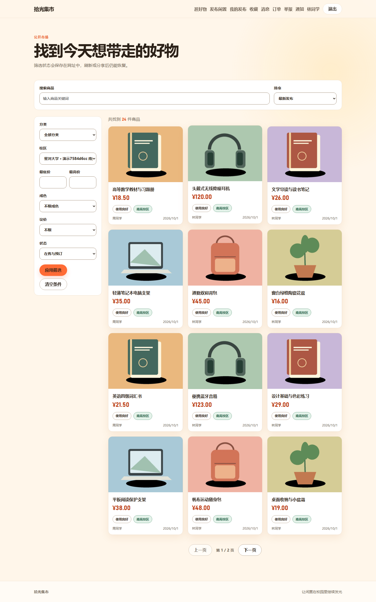

# 拾光集市 · 前端

基于 Vue 3 与 TypeScript 的校园交易应用。页面采用温暖纸色、绿色强调和响应式布局，覆盖商品发现、发布、聊天、面交订单、账户及运营后台。



## 主要页面

| 区域     | 页面                                                       |
| -------- | ---------------------------------------------------------- |
| 公开浏览 | 首页、市场、商品详情、隐私说明                             |
| 账户     | 注册、登录、找回密码、账户安全、校园认证                   |
| 交易     | 分步发布、我的商品、收藏、聊天、订单与评价                 |
| 治理     | 通知、举报记录、处罚申诉                                   |
| 后台     | 审核、运营概览、用户与商品、校园申诉、目录、工作人员和审计 |

窄屏导航通过菜单按钮展开，支持键盘 Escape 关闭。动效尊重减少动态效果偏好；页面提供加载、空数据和错误状态。

## 运行

使用 Node.js 24 和 pnpm 9.15.9，在本目录执行：

```powershell
pnpm install --frozen-lockfile
pnpm dev --host 127.0.0.1
```

后端应运行在 `127.0.0.1:8000`。Vite 开发服务器将 `/api`（包括 WebSocket）代理到后端，访问 [本地前端](http://127.0.0.1:5173)。

```powershell
pnpm typecheck
pnpm lint
pnpm format:check
pnpm build
pnpm preview --host 127.0.0.1
```

`preview` 用于本地检查构建产物。正式发布需要配置静态文件服务、SPA history 回退、API 和 WebSocket 反向代理，见 [发布流程](../docs/发布流程.md)。

## API 配置

同源部署时 `VITE_API_BASE_URL` 留空。跨源时填写后端纯 origin（例如 `https://api.example.com`），不要附加 `/api` 或 `/api/v1`，客户端路径已包含此前缀。WebSocket 地址由对应 HTTP origin 推导。

所有 `VITE_*` 变量都会进入浏览器构建产物，只允许公开配置。Access Token 保存在内存中，刷新凭据由 HttpOnly Cookie 管理；跨源部署还需配置后端允许来源和 Cookie 策略。

## 代码组织

```text
src/api/           类型与 HTTP / WebSocket 客户端
src/components/    复用界面、导航、商品与治理组件
src/views/         用户及后台页面
src/stores/        身份等 Pinia 状态
src/router/        路由与登录、改密、暂停账户导航门禁
src/styles/        颜色、排版、布局与响应式样式
```

商品草稿按账户和商品分别保存。旧版未记录所属账户的草稿需要本人明确恢复或删除。图片上传与保存顺序执行，离开发布页会取消上传并停止后续自动保存；服务端仍对每次操作执行最终权限与业务校验。

项目收尾已移除开发演示页和测试文件。后续修改应补充对应组件与真实浏览器回归验证，检查手机、平板和桌面布局。

更多截图和系统介绍见 [项目 README](../README.md)。
